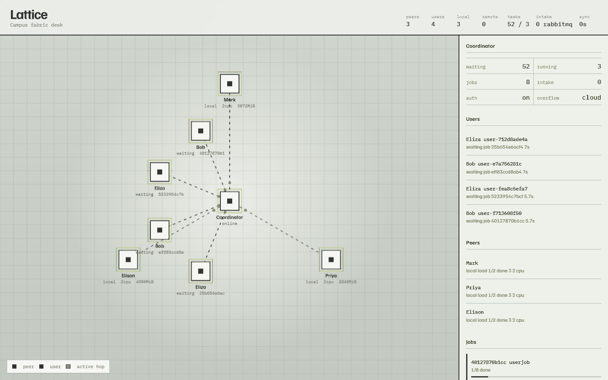
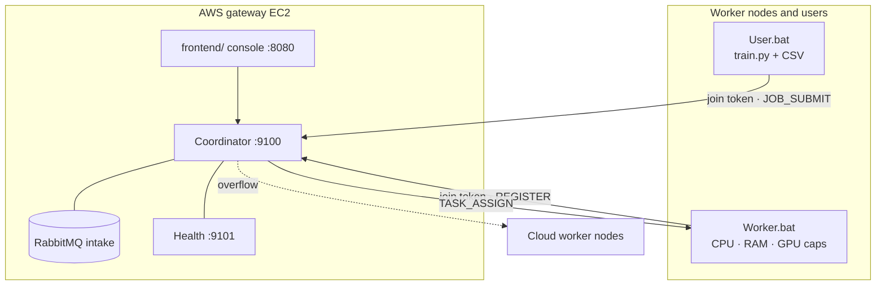

# Lattice

[](https://www.python.org/)
[](docs/aws_deployment.md)
[](https://www.rabbitmq.com/)
[](tests/)

> Consent-driven **campus fabric desk**: **worker nodes** donate CPU/RAM, **users** submit `train.py` + CSV, and a live **coordinator** on AWS shards work across the grid.

<p align="center">
  
</p>

<p align="center"><sub>Live demo — worker nodes <b>Elison</b>, <b>Mark</b>, <b>Priya</b> · users <b>Eliza</b> / <b>Bob</b> submitting shards</sub></p>

<p align="center">
  <a href="#features">Features</a> ·
  <a href="#architecture">Architecture</a> ·
  <a href="#quick-start">Quick start</a> ·
  <a href="#project-layout">Layout</a> ·
  <a href="#tests">Tests</a> ·
  <a href="#documentation">Docs</a>
</p>

---

## Table of contents

- [Features](#features)
- [Architecture](#architecture)
- [How it works](#how-it-works)
- [Quick start](#quick-start)
  - [Worker nodes](#worker-nodes)
  - [Users](#users)
  - [Operator (deploy once)](#operator-deploy-once)
- [Project layout](#project-layout)
- [Ports and tokens](#ports-and-tokens)
- [CLI submit](#cli-submit)
- [Tests](#tests)
- [Documentation](#documentation)

---

## Features

| Capability | Detail |
|------------|--------|
| Worker nodes | `Worker.bat` — name, CPU/RAM/GPU caps, max parallel tasks, consent |
| Users | `User.bat` — upload `train.py` + CSV; appear on the live map |
| Live console | Fabric desk at `:8080` — workers, users, jobs, intake |
| Fair scheduling | Least-load / round-robin across campus worker nodes |
| RabbitMQ intake | Whole jobs queue when the coordinator is at capacity |
| Fail-fast submits | **No worker nodes → reject** (`no workers connected`); nothing queued |
| Cloud overflow | Optional burst worker nodes under policy |
| Isolated userjobs | Each shard runs in a subprocess (`train_shard`) |

---

## Architecture



```text
 User.bat ──JOB_SUBMIT──► COORDINATOR :9100 ◄──REGISTER── Worker.bat
                              │
                     ┌────────┴────────┐
                     │ scheduler       │
                     │ package store   │
                     │ fair least-load │
                     └────────┬────────┘
                              │ at job capacity only
                              ▼
                        RabbitMQ intake
                              │
                              ▼
                     Lattice console :8080
```

---

## How it works

1. **Operator** deploys the gateway once (`DeployGateway.bat`) — coordinator, console, RabbitMQ.
2. **Worker nodes** join with the shared token and donate resource caps.
3. **Users** upload a package; the coordinator shards the CSV and assigns tasks.
4. Shards run on worker nodes; results merge back to the user session.
5. The console shows topology: workers (blue), users (brown), active hops (gold).

### waiting vs intake

| Console field | Meaning | Where |
|---------------|---------|--------|
| **waiting** | Task shards of an admitted job, not yet on a worker node | In-memory scheduler |
| **intake** | Whole jobs waiting because too many jobs are already running | **RabbitMQ** |

`waiting: 4` with `intake: 0` is expected when a live job still has unassigned shards.

---

## Quick start

You need this repo, the **gateway IP**, and the **join token** (`key/join_token.txt`).

Console: `http://GATEWAY_IP:8080`

### Worker nodes

```text
1. Double-click Worker.bat
2. Enter gateway IP + join token (defaults from config/token file if present)
3. Set display name, CPU, RAM, GPU, max tasks
4. Leave the window open — you appear on the console as a peer
```

### Users

```text
1. Double-click User.bat
2. Same gateway IP + join token
3. Pick train.py + CSV (and label column / chunks as prompted)
4. Watch progress in the console; logout removes your user node
```

Your `train.py` must define:

```python
def train_shard(header, rows, params):
    ...
    return {"checksum": ..., "weights": [...], "bias": ...}  # as needed
```

### Operator (deploy once)

```powershell
$env:HPC_JOIN_TOKEN = "your-secret"
.\DeployGateway.bat
```

Do **not** redeploy for each job. Worker nodes use `Worker.bat`; users use `User.bat`.

Local (no AWS): run `Host.bat` on one machine, then point worker nodes / users at that LAN IP.

---

## Project layout

```text
.
├── frontend/                 # Lattice console (HTML / CSS / JS)
├── backend/
│   ├── master/               # Coordinator, upload_job, scheduler, intake
│   ├── worker/               # Worker-node agent, consent, QoS, userjob runtime
│   ├── protocol/             # TCP JSON line messages
│   ├── kernels/              # OpenMP native helpers
│   └── dashboard/            # Flask API serving frontend/
├── scripts/                  # Deploy, join helpers, live stress
├── config/                   # default.yaml · enterprise.aws.yaml
├── examples/ · test/         # Sample train.py + CSV packages
├── tests/                    # Unit + local integration
├── Worker.bat                # Worker-node entry
├── User.bat                  # User entry
├── DeployGateway.bat         # One-shot AWS gateway
└── Host.bat                  # Local coordinator
```

Set `PYTHONPATH` to `backend/` for all Python entrypoints.

---

## Ports and tokens

| Port | Service |
|------|---------|
| `9100` | Coordinator (fabric TCP) |
| `8080` | Lattice console |
| `9101` | Health JSON |
| `5672` | RabbitMQ (on gateway) |

Auth: `HPC_JOIN_TOKEN` or `key/join_token.txt`. Submits with **zero worker nodes** are rejected immediately.

---

## CLI submit

```powershell
$env:PYTHONPATH = Join-Path (Get-Location) "backend"
$env:HPC_JOIN_TOKEN = (Get-Content .\key\join_token.txt -Raw).Trim()

py -3 -m master.upload_job `
  --master "GATEWAY_IP:9100" `
  --token $env:HPC_JOIN_TOKEN `
  --user-name Eliza `
  --train examples/matmul_eliza/train.py `
  --dataset examples/matmul_eliza/A.csv `
  --chunks 6 `
  --policy campus_only
```

---

## Tests

```powershell
$env:PYTHONPATH = Join-Path (Get-Location) "backend"
$env:HPC_ALLOW_TEST_QUEUE = "1"
py -3 -m pytest tests -q
```

Live fabric (worker nodes must already be joined):

```powershell
py -3 scripts/live_system_stress.py --master GATEWAY_IP:9100 --token $env:HPC_JOIN_TOKEN
```

---

## Documentation

| Doc | Contents |
|-----|----------|
| [`docs/architecture.md`](docs/architecture.md) | Design, protocol, reclaim / burst |
| [`docs/aws_deployment.md`](docs/aws_deployment.md) | AWS gateway ops |
| [`docs/user_guide.md`](docs/user_guide.md) | Operator notes |
| [`examples/`](examples/) · [`test/`](test/) | Sample userjobs |

---

<p align="center">
  <sub>Lattice — campus fabric desk · worker nodes · users · AWS coordinator</sub>
</p>
