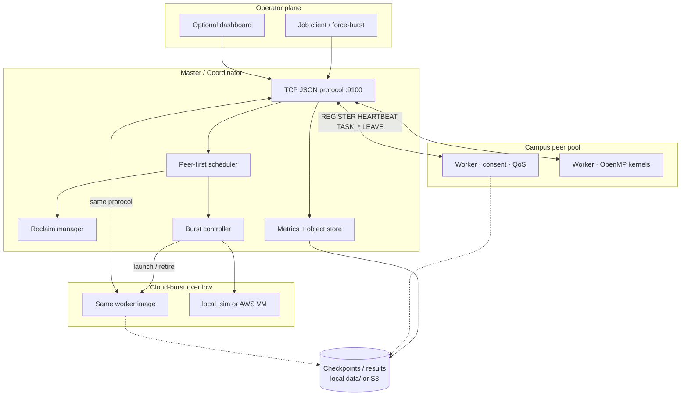
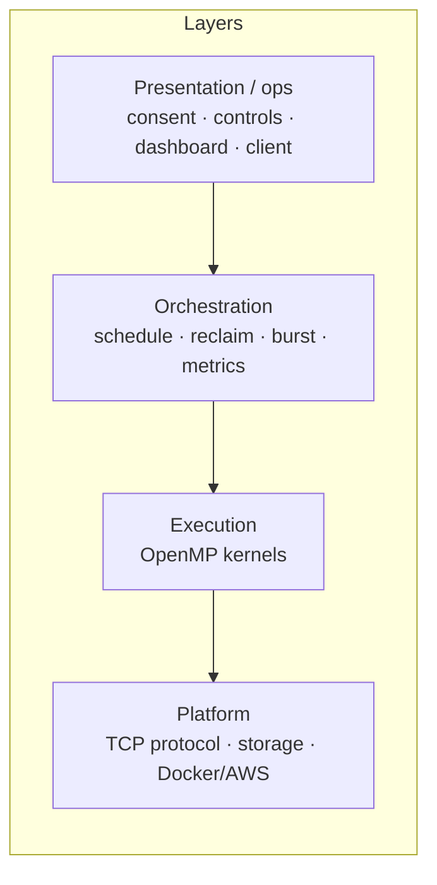

# Hybrid Consent-Driven Desktop Grid

<p align="center">
  <a href="#-about">About</a> &nbsp;•&nbsp;
  <a href="#-the-solution-architecture">The Solution Architecture</a> &nbsp;•&nbsp;
  <a href="#-research">Research</a> &nbsp;•&nbsp;
  <a href="#-running">Running</a> &nbsp;•&nbsp;
  <a href="#-tests">Tests</a> &nbsp;•&nbsp;
  <a href="#-references">References</a> &nbsp;•&nbsp;
  <a href="#-tech-stack">Tech Stack</a>
</p>

<p align="center">
  <em>Campus-first scientific computing · OpenMP workers · reclaim-aware scheduling · policy-driven cloud burst</em>
</p>

| Layer | Artifact | Status |
|-------|:--------:|:------:|
| OpenMP kernels | `heat2d` · `batch` · `irregular` | implemented |
| Master / coordinator | peer-first · reclaim · burst | implemented |
| Campus worker | consent · QoS · pause/leave | implemented |
| Cloud overflow | `local_sim` · AWS stubs | implemented |
| Experiment package | campus / hybrid / reclaim / cloud_only | implemented |

> Deep design notes (layers, protocol, reclaim/burst, deployment): **[`docs/architecture.md`](docs/architecture.md)**

---

## About

The main objective of this **hybrid HPC–cloud** project is a working prototype of **interrupt-tolerant scientific computing** on **consented campus workstations**, with **short-lived cloud overflow** when peer capacity, reclaim pressure, or deadline risk demands it.

University labs and student laptops hold large amounts of unused CPU during free periods and idle intervals. Dedicated clusters are expensive; continuous public-cloud use is expensive too. Existing volunteer platforms prove idle pooling is feasible, yet classroom reality differs: a participant may **withdraw at any moment**, and the owner’s interactive work must not be harmed.

This repository interprets that problem as an integrated fabric:

- **Consent-first** campus peers (plain-language disclosure before any remote work)
- **OpenMP** shared-memory parallelism *inside* each worker
- **Task-queue** distribution *across* machines (churn-tolerant; not default MPI-over-Wi-Fi)
- **Reclaim as a normal event** (checkpoint + requeue), not a rare failure
- **Policy-driven cloud burst** that prefers campus capacity and retires idle VMs

> Idle campus workstations can support meaningful scientific computing when participation is consented, interruption is expected, and multicore CPUs are used carefully.

### Give a Star!

If this research prototype is useful for your course, lab, or paper baseline, consider starring the repository.

---

## The Solution Architecture



**Fig. 1** — Hybrid logical architecture: campus peers with cloud-burst overflow.



**Fig. 2** — Layered software view (orchestration separates volatile peers from local OpenMP speedup).

> Full narrative, message table, policy conditions, and repository build map: [`docs/architecture.md`](docs/architecture.md)

---

## Research

<details>
<summary><strong>Volunteer computing &amp; desktop grids</strong></summary>

<br/>

BOINC-style and institutional desktop grids show that idle PCs can host scientific work units. Classroom sessions differ from wide-area donation: participation is short, supervised, and LAN-oriented; tasks must tolerate rapid leave.

This project keeps the **opt-in client–server work-unit** idea, but scopes it to a **consent popup + campus peer pool**, with OpenMP inside each volunteer worker.

</details>

<details>
<summary><strong>Reclaim as a first-class event</strong></summary>

<br/>

Cluster managers often treat node loss as failure. Campus GPU-sharing research stresses **owner autonomy**: reclaim without prior negotiation.

Here, leave and missed heartbeats **requeue** unfinished chunks. Optional checkpoints land in local/`S3` storage. End-to-end **reclaim recovery** is measured from requeue until successful re-complete—not only leave-handler latency.

</details>

<details>
<summary><strong>Hybrid parallelism: OpenMP inside, tasks across</strong></summary>

<br/>

Hybrid MPI+OpenMP is mature on stable clusters. On volatile student devices, tightly coupled MPI is a poor default.

The pragmatic split used here:

```text
Job
 └─ distributed task queue          ← across campus / cloud workers
      └─ OpenMP parallel region    ← inside each worker (CPU-capped)
```

Kernels: tiled **heat2d**, embarrassingly parallel **batch**, mildly **irregular** work for stragglers.

</details>

<details>
<summary><strong>Owner QoS as a scheduling constraint</strong></summary>

<br/>

Throughput-maximizing grids can ignore browser/IDE latency. This prototype treats owner protection as first-class:

| Control | Mechanism |
|---------|-----------|
| Consent gate | Work starts only after acceptance |
| CPU cap | `OMP_NUM_THREADS` / kernel `--threads` |
| Process priority | Below-normal by default |
| Idle-only | Wait on low CPU busy ratio |
| Pause / leave | Stdin `p` / `r` / `l` (+ protocol) |

</details>

<details>
<summary><strong>Policy-driven cloud burst</strong></summary>

<br/>

Industry hybrid HPC–cloud practice uses on-prem/edge first, then bursts under load or deadline pressure.

Burst when **any** configured condition holds (under a max VM cap):

- Too few consented campus peers
- Sustained high reclaim / retry pressure
- Projected finish misses the deadline
- Operator force-burst (controlled experiments)

Idle cloud workers shut down after timeout. Modes: **`local_sim`** (same process image) and **`aws`** (operator AMI/scripts).

</details>

<details>
<summary><strong>Research gaps addressed</strong></summary>

<br/>

| Gap | Claim in this prototype |
|-----|-------------------------|
| A — Reclaim on campus peers | Leave/heartbeat → requeue + optional checkpoint |
| B — Owner QoS | Caps, priority, idle-only, one-click leave |
| C — Hybrid local parallelism | OpenMP in-worker + task queue across nodes |
| D — Policy cloud burst | Peer shortage / reclaim / deadline / force |
| E — Lightweight stack | Minimal consent-first fabric vs heavy middleware |

</details>

---

## Running

### Multi-laptop classroom (easiest)

Put the same repo folder on every laptop (clone or USB copy). Same Wi‑Fi.

| Role | Double-click |
|------|----------------|
| **Your host laptop** | [`Host.bat`](Host.bat) — builds deps, opens port 9100, starts master, **prints the IP** |
| **Other laptops** | [`Connect.bat`](Connect.bat) — asks for that IP, joins the pool |
| **Host (2nd window)** | [`SubmitJob.bat`](SubmitJob.bat) — runs a campus job once workers are registered |

Worker hotkeys after connect: `p` pause · `r` resume · `l` leave · `s` status.

**Resource donation:** `Connect.bat` asks how many **CPU threads**, how much **RAM (MiB)**, and **max parallel tasks** to share (saved in `config/worker_local.yaml`). **GPUs** can be advertised for inventory, but current kernels are **CPU/OpenMP only** (not scheduled on GPU yet).

First time on each PC you need Python 3 + a `g++` with OpenMP (MSYS2 MinGW64 on Windows). After that, Host/Connect handle the rest.

### One-shot local demo (single PC)

```powershell
.\scripts\run_all.ps1
```

### Policies

| Policy | Behavior |
|--------|----------|
| `campus_only` | No cloud overflow |
| `hybrid` | Peer-first + policy burst |
| `cloud_only` | Burst workers only |

### AWS curriculum deploy (Master = Gateway)

Lean enterprise posture: **thin AWS control plane**, join-token auth, health probes, audit log, optional S3 durability — not K8s/API-GW sprawl.

```text
SubmitJob / Connect.bat  →  AWS EC2 Master:9100  →  campus workers (+ optional burst VMs)
                              health :9101          S3 checkpoints (optional)
```

1. `aws configure`
2. (Recommended) `$env:HPC_JOIN_TOKEN = "long-random-secret"`
3. Double-click [`DeployGateway.bat`](DeployGateway.bat)
4. Wait ~2 minutes; check `http://<ip>:9101/health`
5. `Connect.bat` → public IP **and join token**
6. `SubmitJob.bat` (same token via env)

Ops: [`docs/enterprise_ops.md`](docs/enterprise_ops.md) · Topology: [`docs/aws_deployment.md`](docs/aws_deployment.md) · Profile: [`config/enterprise.aws.yaml`](config/enterprise.aws.yaml)

### Experiments

```powershell
.\scripts\run_experiments.ps1
```

More ops detail: [`docs/user_guide.md`](docs/user_guide.md)

---

## Tests

```powershell
$env:PYTHONPATH = (Get-Location)
py -3 -m pytest tests -q
```

| Suite | Focus |
|-------|--------|
| Unit | Protocol, scheduler, burst policy, storage/metrics, consent/QoS, idle, reclaim recovery, idle retire |
| Integration | Master + campus worker + job completion |
| Kernels | OpenMP binary self-consistency |

---

## References

Indicative sources from the project brief (expand to full bibliography as required by your venue):

- Anderson, D. P. — BOINC / public-resource computing
- Litzkow, Livny, Mutka — Condor / HTCondor idle-workstation harvesting
- Rabenseifner, Hager, Jost — Hybrid MPI/OpenMP on multicore SMP nodes
- Application-level checkpointing for hybrid codes (e.g. Losada et al.)
- Campus reclaim-oriented sharing literature; cloud-burst / hybrid HPC–cloud surveys
- Desktop-grid institutional work (e.g. SZTAKI Desktop Grid)

Project ethics & consent drafts: [`docs/ethics.md`](docs/ethics.md), [`consent/consent_form.md`](consent/consent_form.md)

---

## Tech Stack

### Worker / execution

- **C++17 + OpenMP** — `kernels/omp_kernels.cpp` scientific kernels
- **Python 3.10+ worker agent** — consent, QoS, TCP client, kernel runner (`python -m worker`)

### Master / orchestration

- **Python asyncio TCP server** — scheduler, reclaim, burst, metrics (`python -m master`)
- **Ray-inspired core (adapted)** — logical resources, ObjectRef/lineage, GCS, max_retries — not the Ray package; see [`docs/ray_inspired_core.md`](docs/ray_inspired_core.md)
- **PyYAML** — `config/default.yaml`
- **Flask** — optional dashboard
- **boto3** — optional S3-compatible object store

### Platform & ops

- **Newline-delimited JSON over TCP** — control + data plane
- **Docker** — cloud worker image (`docker/Dockerfile`)
- **AWS CLI stubs** — `scripts/aws_launch_worker.*` (operator fills AMI/SG/subnet)
- **pytest** — unit + integration verification
- **PowerShell / bash** — build, demo, experiment runners

### Repository map

| Path | Role |
|------|------|
| [`docs/architecture.md`](docs/architecture.md) | Full architecture narrative |
| `kernels/` | OpenMP kernels |
| `master/` | Coordinator stack |
| `worker/` | Campus/cloud agent |
| `protocol/` | Wire messages |
| `config/` | Thresholds & workloads |
| `scripts/` | Single-run + AWS |
| `tests/` | Automated checks |

---

## Contributing

Course/lab contributions welcome: keep OpenMP kernels deterministic where claimed, preserve consent-before-work, and extend experiments with CSV/JSON traces under `data/logs`.

## Authors

See the repository contributors graph for participants on this codebase.

## License

Use according to your course / institutional submission rules unless a `LICENSE` file is added to this repository.
