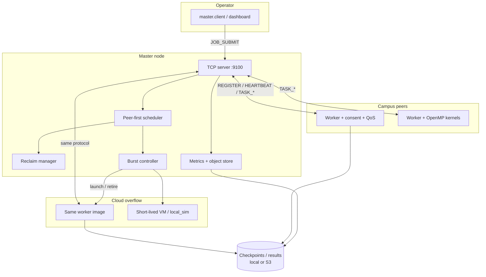
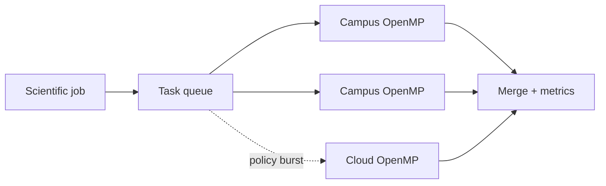

# Hybrid Consent-Driven Desktop Grid

**Hybrid Consent-Driven Desktop Grid with Cloud-Burst Overflow for Interrupt-Tolerant Scientific Computing on Campus Workstations**

Campus-first master–worker grid: **OpenMP inside each worker**, reclaim-aware task redistribution, and **policy-driven cloud-burst** overflow. Built for classroom/LAN pilots with optional free-tier AWS (operator-owned).

> Full modeling, layers, protocol, reclaim/burst paths, and build map: **[`docs/architecture.md`](docs/architecture.md)**

---

## Architecture at a glance





How layers, messages, reclaim, and burst decisions fit together is documented in [`docs/architecture.md`](docs/architecture.md) — not duplicated here.

---

## Quick start

```powershell
.\scripts\run_all.ps1
```

Builds OpenMP kernels → installs Python deps → runs tests → local hybrid demo → experiment traces (`data/logs`, `experiments/out`).

### Manual

```powershell
.\scripts\build_kernels.ps1
py -3 -m pip install -r requirements.txt
$env:PYTHONPATH = (Get-Location)
py -3 -m master
# other terminals:
py -3 -m worker --master 127.0.0.1:9100 --auto-consent
py -3 -m master.client --kernel heat2d --policy hybrid --chunks 8
```

AWS: fill `config/default.yaml` → `burst.aws_*`, set `burst.mode: aws`. Stubs: `scripts/aws_launch_worker.ps1`. Details in the architecture doc’s deployment section.

---

## Repository map

| Path | Role |
|------|------|
| [`docs/architecture.md`](docs/architecture.md) | Full system design (read this) |
| `kernels/` | OpenMP `heat2d` · `batch` · `irregular` |
| `master/` | Coordinator, scheduler, burst, metrics, storage, client |
| `worker/` | Consent, QoS, stdin controls, kernel runner |
| `protocol/` | JSON/TCP messages |
| `config/` | Thresholds, ports, workloads, burst mode |
| `dashboard/` | Optional status UI |
| `docker/` | Cloud worker image |
| `scripts/` | Build, demo, experiments, AWS launch |
| `tests/` | Unit + integration |
| `consent/` · `docs/` | Ethics, user guide, requirements, coverage |

---

## Ops cheat sheet

| Topic | Values |
|-------|--------|
| Policies | `campus_only` · `hybrid` · `cloud_only` |
| Burst triggers | Peer shortage · reclaim storm · deadline risk · force |
| Owner keys | `p` pause · `r` resume · `l` leave · `s` status |
| Metrics | Speedup, efficiency, reclaim recovery, cloud cost proxy, leave latency |

More operations: [`docs/user_guide.md`](docs/user_guide.md)
