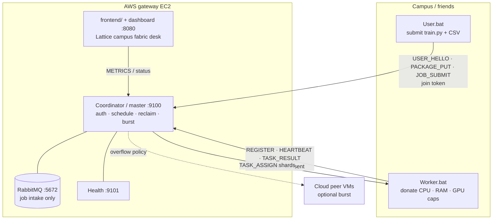

# Lattice

**Campus fabric desk** — a consent-driven desktop grid. Classmates donate CPU/RAM as **peers**, submitters upload `train.py` + CSV as **users**, and a live **coordinator** on AWS shards work across the fabric. The console map at `:8080` is the control surface you see in class.

Live console (example): `http://GATEWAY_IP:8080` · Fabric port `:9100` · Health `:9101`

---

## Architecture



### Runtime picture

```text
                         ┌──────────────────────────┐
                         │   Lattice console :8080  │
                         │   peers · users · jobs   │
                         └────────────┬─────────────┘
                                      │ /api/status
                                      ▼
   User.bat ──JOB_SUBMIT──►  COORDINATOR :9100  ◄──REGISTER── Worker.bat
   (Eliza, Bob, …)           │  scheduler          │           (Aejaz, Divyesh, …)
                             │  package store      │
                             │  fair least-load    │
                             └─────────┬───────────┘
                                       │
                         whole jobs only when at capacity
                                       ▼
                                 RabbitMQ intake
```

| Role | How you join | What you do |
|------|----------------|-------------|
| **Coordinator** | `DeployGateway.bat` once | Auth, partition, schedule, reclaim, cloud overflow |
| **Peer (worker)** | `Worker.bat` + token | Donate caps (CPU/RAM/GPU/max tasks); run shards |
| **User** | `User.bat` + token | Upload code+data; appear on the map; get results |
| **Console** | Browser → `:8080` | Live topology: peer / user / active hop |

### Two queues (do not confuse them)

| Console field | Meaning | Storage |
|---------------|---------|---------|
| **waiting** | Task shards of an **already admitted** job, not yet on a peer | In-memory scheduler |
| **intake** | Whole **jobs** blocked because too many jobs are already running | **RabbitMQ** |

So `waiting: 4` + `intake: 0` is normal: the job is live; shards are waiting for peers, not sitting in RabbitMQ.

### Submit rules

- Join token required (`key/join_token.txt` / `HPC_JOIN_TOKEN`).
- **No peers → submit rejected** (`no workers connected`); nothing is queued.
- With peers: job shards fair-share across least-loaded campus (and cloud under overflow).

---

## Repo layout

```text
frontend/                 Lattice console (HTML / CSS / JS)
backend/
  master/                 Coordinator, upload_job, scheduler, RabbitMQ intake
  worker/                 Peer agent, consent, QoS, userjob runtime
  protocol/               TCP JSON line messages
  kernels/                OpenMP native helpers
  dashboard/              Flask API that serves frontend/
scripts/                  Worker.bat / User.bat helpers, AWS deploy, stress
config/                   default.yaml · enterprise.aws.yaml
examples/  test/          Sample train.py + CSV packages
tests/                    Unit + local integration
Worker.bat  User.bat      Friend entry points
DeployGateway.bat         One-shot AWS gateway
Host.bat                  Local coordinator (no AWS)
```

`PYTHONPATH` always points at `backend/`.

---

## Quick start (friends)

Gateway is already up once on AWS. Share:

1. This repo (or a zip)  
2. **Gateway IP** + **join token** from `key/join_token.txt`  
3. Console URL: `http://GATEWAY_IP:8080`

| You want to… | Run | Notes |
|--------------|-----|--------|
| Donate compute | `Worker.bat` | Name + CPU/RAM/GPU + max tasks; leave window open |
| Submit a job | `User.bat` | Same token; pick `train.py` + CSV |
| Watch the fabric | Browser → `:8080` | Peers = blue, users = brown, active hop = gold |

`train.py` must define `train_shard(header, rows, params)`.

---

## Operator: deploy gateway (once)

```powershell
$env:HPC_JOIN_TOKEN = "your-secret"
.\DeployGateway.bat
```

That boots coordinator + dashboard + Docker RabbitMQ on EC2. **Do not redeploy per job** — friends only run `Worker.bat` / `User.bat`.

Local (no AWS): `Host.bat` on one laptop, then workers/users against that LAN IP.

---

## Advanced submit (CLI)

```powershell
$env:PYTHONPATH = Join-Path (Get-Location) "backend"
$env:HPC_JOIN_TOKEN = (Get-Content .\key\join_token.txt -Raw).Trim()

py -3 -m master.upload_job `
  --master "GATEWAY_IP:9100" `
  --token $env:HPC_JOIN_TOKEN `
  --user-name Eliza `
  --train examples/matmul_eliza/train.py `
  --dataset examples/matmul_eliza/A.csv `
  --chunks 6 `
  --policy campus_only
```

---

## Tests

```powershell
$env:PYTHONPATH = Join-Path (Get-Location) "backend"
$env:HPC_ALLOW_TEST_QUEUE = "1"
py -3 -m pytest tests -q

# Live fabric (workers must already be joined):
py -3 scripts/live_system_stress.py --master GATEWAY_IP:9100 --token $env:HPC_JOIN_TOKEN
```

---

## Docs

- [`docs/architecture.md`](docs/architecture.md) — deep design  
- [`docs/aws_deployment.md`](docs/aws_deployment.md) — AWS ops  
- [`docs/user_guide.md`](docs/user_guide.md) — operator notes  
- [`examples/`](examples/) · [`test/`](test/) — sample userjobs  
